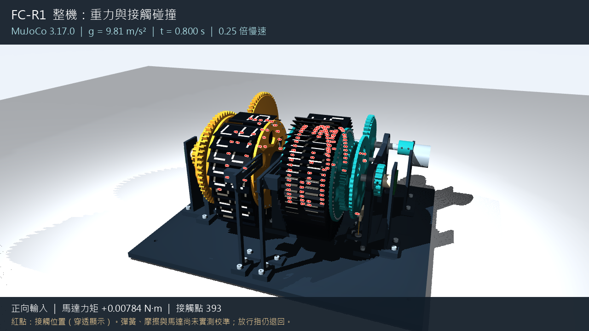

# FC-R1 重力與碰撞檢視

這是全新 FC-R1 CAD 的剛體物理模擬，底座固定，84 片翻片各有獨立鉸鏈。
使用 MuJoCo 3.17.0，重力為 9.81 m/s²。翻片、齒輪、棘爪與定位輪的動作由力與接觸解算；
只有共同輸入軸接受有限馬達力矩。輸出軸沒有指定角度、理想單向離合或定位吸附。

## 直接檢視

- [整機影片](review/physics/physics.mp4)
- [翻片近看](review/physics/front.mp4)
- [傳動背面](review/physics/rear.mp4)



影片回放實際記錄的 1.6 秒物理運算，以 0.25 倍慢速播放，前後各有短暫停留。
紅點是解算器記錄的接觸位置，穿透外觀顯示被遮住的接觸；標記大小不代表間隙或實體尺寸。

從專案根目錄執行下列指令，可重新開啟可旋轉的回放視窗：

```powershell
.\cad\open-physics.ps1
```

- 滑鼠左鍵拖曳：旋轉視角；滾輪：縮放。
- `P`：暫停／繼續；左右方向鍵：逐格檢查。
- `R`：回到開頭；`C`：切換半透明外觀與紅色接觸標記。
- 關閉視窗不會刪除模擬紀錄。

原生互動視窗的桌面操作尚待使用者自行確認；已完成的影像檢查與解算結果另列於下方。

回放讀取已保存的物理軌跡。若要重新解算並試調輸入力矩，執行：

```powershell
.\cad\physics.ps1 view
```

即時解算視窗的右側 `Control` 滑桿範圍為 -1～+1，正值／負值控制輸入方向；0 為停止施加馬達力矩。
馬達提案為堵轉力矩上限 0.025 N·m、無負載轉速 3 rad/s，力矩隨同向轉速下降。
`Space` 暫停／繼續。完整接觸解算速度取決於電腦效能，未承諾達到實時速度。

## 本次實際結果

- 完成 1.6 秒、32,000 個時間步，96 個可動剛體，84 片翻片，沒有數值警告。
- 最大數值穿透約 0.096 mm；這是軟接觸的數值結果，不是製造間隙。
- 前 0.35 秒不施加馬達力矩：開啟重力時 82 片轉動超過 1°，關閉重力時為 0 片。
- 前 0.2 秒以 50／25 微秒時間步比較：翻片角度差 RMS 約 0.098°，最大約 0.975°；未宣稱完整運轉已收斂。
- 六項獨立引擎自測通過，包含自由落體、地面碰撞、摩擦、彈簧、有限馬達力矩及影像輸出。自測不是整機驗收。

運算先讓翻片落下，0.60～0.90 秒施加正向輸入，1.05～1.35 秒施加反向輸入。
在反向輸入窗口，分鼓仍前進約 **20.5°**，顯示目前提案的定位／阻力不足以抑制續轉。
釋放指仍保持 CAD 的退回檢查位置，畫面中的翻片會堆疊，尚未建立穩定的 HH:MM 顯示與單片放行。

## 模型範圍與限制

質量、重心與慣量取自新 CAD 實體及提案密度；彈簧剛度、預壓、摩擦、軸承阻力、馬達曲線仍待實測。
齒輪／棘輪的工作輪廓由原生 CAD 離散化後作凸形分解，保留齒谷與工作孔；
離散化公差為 0.005 mm，另外的平面簡化邊界誤差不超過 0.005 mm，逐輪廓記錄於模型 manifest。
軸承與片銷內部以轉動關節表示；非工作螺絲／減重孔部分填實作碰撞近似，金屬彈簧以力等效表示。
護蓋隱藏僅影響外觀，其已建立的碰撞形體仍參與運算。父子零件接觸保留，沒有為達成動作排除齒輪或棘爪接觸。

採用 `diagexact` 精確計算當前接觸慣量，處理固定軸齒輪質心不平移時的數值問題；未修改零件質量來掩蓋失穩。
可參閱 [MuJoCo 接觸阻抗說明](https://mujoco.readthedocs.io/en/3.17.0/computation/index.html#impedance)。
早期失敗運算保留在本機 `runs/`，未納入 GitHub 回放資料或交付影片。

此模型是探索性剛體／軟接觸檢視；沒有塑料變形、強度、磨耗、聲音或實機耐久證據。
`physics_verified`、`hardware_verified`、`manufacturing_ready` 仍為 false。

## 重跑與資料

其他電腦先完成 `cad/setup.ps1`，再執行 `cad/setup-physics.ps1` 下載固定版本物理套件。
日常指令使用本專案快取，可離線執行：

```powershell
.\cad\physics.ps1 doctor
.\cad\run.ps1 export-physics --units SI
.\cad\run.ps1 simulate --case drive --duration 1.6 --dt 0.00005 --headless
```

每次運算保存模型、來源程式副本、初始條件、版本與雜湊、`states.npz`、`trajectory.csv`、
`energy.csv`、`contacts.csv.gz`、接觸點及 `summary.json`。`reports/physics_assessment.json`
是本次對照結果，`reports/physics_latest.json` 指向這次完成的主運算。

GitHub 的 `review/physics/` 保存這次完成的主運算、影片、模型與兩項對照資料。
`open-physics.ps1` 會先尋找本地 `runs/<run_id>`，再使用 `review/physics/`；
省略的二進位引擎快取會在第一次開啟時重新編譯，不必先重建 CAD。
